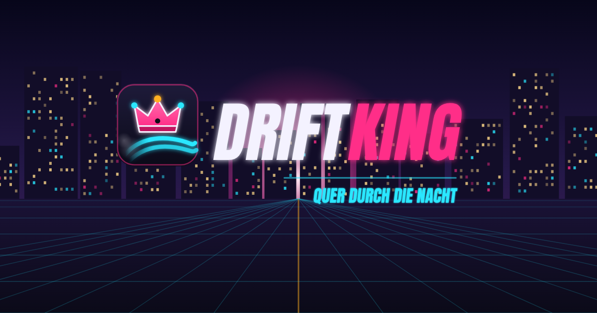

<div align="center">


# DriftKing

**Quer durch die Nacht.**

Nacht-Drift im Stil der japanischen Straßenszene – auf dem Bergpass, dem obersten Parkdeck, zwischen Hafencontainern und im Neon-Viertel:
eigene Autos, Tuning, Wettbewerbe mit Medaillen und Mehrspieler.

</div>



---

## Das Spiel

- 🏁 **Drei Modi** – **Freies Fahren** (ohne Uhr), **Drift-Wertung** (auf Zeit, die meisten Punkte gewinnen), **Rennen** (Runden, die schnellste Zeit).
- 🗺️ **Vier Strecken** – **Tenjō-Pass** (Haarnadeln am Hausberg), **Parkdeck 7** (oberstes Deck eines Parkhauses), **Kaikō-Docks** (Container und Kräne), **Neon-Viertel** (Rundkurs um die Blocks).
- 🚗 **Garage** – acht eigene Autos (Heck- und Allradantrieb), Tuning in fünf Stufen (Motor, Turbo, Fahrwerk, Reifen, Lenkwinkel-Kit), Lack, Felgen, Neon unterm Auto, Designs und Startnummer.
- 🏆 **Wettbewerbe** – feste Aufgaben mit Bronze, Silber und Gold; jede Medaille zahlt einmal Preisgeld. Die Administration legt neue an.
- 📈 **Wertung** – Punkte nach Winkel × Tempo, Ketten mit Multiplikator bis ×5, Bonus nah an der Wand („Wandkuss“) und im Tandem, „CRASH“ kostet die Kette.
- 🖥️ **HUD** – Tacho, Drehzahl und Gang, Driftwinkel-Anzeige, Pedalstellung (Gas, Bremse, Handbremse) und Lenkung, Kette und Multiplikator, Zeit, Runde, Platz, Minikarte.
- 🌐 **Mehrspieler** – Räume mit Code und Einladungslink, mit oder ohne Bots; offline in der App gegen Bots.
- ⚡ **Grafik auf Tempo** – bewusst stilisiert (Low-Poly, Neon, Nebel) statt fotorealistisch, drei Qualitätsstufen.

**Steuerung:** W/S Gas/Bremse · A/D lenken · Leertaste Handbremse · Q/E schalten (manuell) · C Kamera · R zurück auf die Strecke · Esc Pause.
Gamepad: RT/LT, Stick, A Handbremse, LB/RB schalten, Y Kamera, B zurücksetzen.

## So läuft es

DriftKing ist ein **Spiel von [MatGame](https://github.com/Real-TTX/MatGame)** – dem Server der Mat-Spiele mit Portal, Konten, Gästen und Administration.

| Weg | Adresse | Was |
|---|---|---|
| **MatGame** (alle Spiele) | `http://<server>:2770/driftking/` | das Image `ghcr.io/real-ttx/matgame` |
| **DriftKing allein** | `http://<server>:2771/driftking/` | das Image `ghcr.io/real-ttx/driftking` (MatGame-Server nur mit DriftKing) |
| **Windows-App** | `DriftKing.exe` aus den Releases | online gegen einen Server oder **offline** gegen Bots |

```bash
docker compose up -d                                       # Release (:latest)  → http://localhost:2771/driftking/
docker compose -f docker-compose.dev.yml up -d             # Nightly (:nightly)
docker compose -f docker-compose.local.yml up -d --build   # selbst gebaut (braucht ../MatGame), mit pgAdmin auf 2778
```

Das **erste Konto**, das sich registriert, ist Administrator. Die Verwaltung liegt unter **/Admin → DriftKing**:
Übersicht, Fahrer, Läufe, Autos, Strecken, Wettbewerbe, Einstellungen.

| Datei | Kanal | Image |
|---|---|---|
| `docker-compose.yml` | Release (Branch `main`) | `ghcr.io/real-ttx/driftking:latest` |
| `docker-compose.dev.yml` | Nightly (Branch `dev`) | `ghcr.io/real-ttx/driftking:nightly` |
| `docker-compose.local.yml` | lokal gebaut | `driftking:local` |

Versionen: Release `<major>.<minor>.<build>-<datum>`, Nightly `nightly-<build>-<datum>`, lokal `local-<datum>`.

## Entwickeln

Alle Repos liegen nebeneinander: `Development/MatGame`, `Development/DriftKing`.

```powershell
./scripts/redeploy.ps1                  # eigener Stack: http://localhost:2771/driftking/ (pgAdmin 2778, Postgres 2780)
./scripts/redeploy.ps1 -MatGame         # MatGame-Stack mit allen Spielen: http://localhost:2770/driftking/
dotnet build DriftKing.slnx
dotnet test DriftKing.slnx
node scripts/serve.mjs                  # Vorschauen ohne Server: /driftking/dev/drive.html, garage.html, maps.html
```

Mehr in [CLAUDE.md](CLAUDE.md) (Aufbau, Regeln) und [docs/PROTOCOL.md](docs/PROTOCOL.md) (API, Hub, offline).

## Lizenz

© Matthias Schmoldt. Alle Rechte vorbehalten. Schriften: Anton, Inter (SIL Open Font License, siehe `wwwroot/fonts`). three.js und SignalR: MIT.
